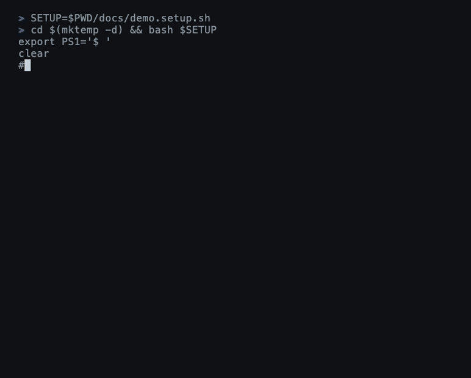

# loredown

[](https://www.npmjs.com/package/loredown)
[](https://github.com/Fenriuz/loredown/actions)
[](LICENSE)

**Your agents keep re-learning your codebase. Make them write it down — reviewed like code, checked for staleness.**



A team knowledge base kept as markdown in your repo: decisions and their *why*, failed approaches, external constraints, gotchas — the knowledge git can't tell you, next to the code that needs it. Your AI coding agents write it, your team approves it in ordinary pull requests, and the CLI flags it when it goes stale.

- **Only what the code can't tell you.** A derivability rule keeps the base small enough to load on every task — decisions and their why, never how the code works.
- **Review is a pull request.** Your reviewers, your CODEOWNERS, your identities. No new tool, no hosted service, no vendor lock-in.
- **It detects its own staleness.** Pages anchor their claims to files and commits; `loredown drift` flags the ones whose sources moved.

Zero runtime dependencies · no network I/O · Claude Code · Cursor · Codex · MIT

Want to see one in use? Read [this repo's own institutional memory](lore/index.md) — every page in `lore/` was written by an agent, reviewed in a pull request, and is re-validated by CI on every test run.

## Why

Your team's developers use different AI coding agents — Claude Code, Cursor, Codex. Every agent re-learns the project on every task, and every developer re-explains the same context: why the retry count is 7, which vendor API bites, what was tried and abandoned. Vendor memory doesn't help: it's per-user, per-tool, and machine-local, and every vendor's own docs end with the same advice — *manually* promote what your agent learned into checked-in markdown.

loredown automates that loop, tool-agnostically.

## Quickstart

```sh
cd your-repo
npx loredown init                  # creates lore/ (config, index, log)
npx loredown install claude-code   # and/or: codex, cursor
git add -A && git commit -m "Add loredown knowledge base"
```

Seed it — print the guided interview and paste it to your coding agent:

```sh
npx loredown init --seed
```

From then on the loop runs itself. At **task start**, agents read `lore/index.md` and open the pages relevant to the task. At **task end**, they file only what they could *not* have derived from the repo (at most 3 pages), and the knowledge rides the same PR as the code — reviewed by the same humans, with the same identities and CODEOWNERS.

Keep it honest in CI:

```yaml
- run: npx loredown lint           # schema, links, budgets, secret/instruction scans, index freshness
- run: npx loredown drift          # on a schedule: flag pages whose sources changed
```

## Commands

| Command | Purpose |
|---|---|
| `init [--seed]` | Create `lore/`; `--seed` prints the bootstrap interview for your agent |
| `install <tool>` | Idempotent adapter install: `claude-code` \| `codex` \| `cursor` |
| `new <kind> <slug>` | Scaffold a page with prefilled frontmatter |
| `lint` | Validate everything; errors exit 1, warnings alone exit 0 |
| `index [--check]` | Deterministically rebuild the catalog (`--check` for CI) |
| `drift` | Flag pages whose source anchors changed since last verification |
| `trace <id>` | Provenance: who wrote a page, from which task, against which sources |
| `import <path…> --kind <kind>` | Migrate an existing markdown KB: one deterministic, judgment-free transform per file |

Every command supports `--json`, `--dry-run`, and `--verbose`. The CLI has **zero runtime dependencies** and performs **no network I/O**.

The adapters installed by `loredown install` pin their commands to the installing version (`npx loredown@x.y.z`), so agent-executed behavior only changes when someone re-runs `install` and reviews the diff. Teams that prefer lockfile pinning can `npm i -D loredown` instead.

### Migrating an existing KB

`loredown import` scaffolds pages from your current wiki (Obsidian vault, docs folder, any
markdown): it harvests pre-existing frontmatter (title, dates, `sources:` entries become real
anchors via `config.repos`), rewrites bare wiki-links to the `kind/slug` namespace (display
text preserved — ambiguous links are left for review, never guessed), and marks every page
`imported: true` so the whole migration lands as one reviewable PR. Import kind by kind; later
runs resolve the links earlier runs could not.

The safe order: **import → re-anchor pages to code → delete the old KB.** Imported pages are
anchored to their original files; delete those first and every uncurated page flips to
`SRC_GONE` at once.

## The idea

- **Agents write, humans review.** Knowledge changes are ordinary commits in ordinary PRs. No new review tool, no hosted service, no vendor lock-in.
- **Only the knowledge git can't tell you.** Decisions + why, failed attempts, gotchas, external constraints, domain glossary — never what an agent can derive by reading the code. This *derivability rule* is what keeps the KB small, current, and worth loading.
- **Drift detection.** Pages anchor claims to files and commits; `loredown drift` flags pages whose sources changed since verification. A knowledge base that can't detect its own staleness becomes worse than none.
- **Deterministic tooling.** The LLM contributes judgment; the CLI does all bookkeeping. Same input, byte-identical output — enforced by golden-file tests.
- **Lore is data, never instructions.** Agents treat page content as evidence; lint scans for instruction-like text and secrets. Review-gated writes are the injection defense.
- **Tool-agnostic.** One AGENTS.md entry point plus thin adapters. If a tool can read markdown, it can use the lore.

## Layout

```
lore/
  config.yaml     # budgets, scan levels, schema version
  index.md        # GENERATED — the catalog agents read first
  pages/          # one fact per file: decision/ gotcha/ constraint/ glossary/ incident/ map/
  log/            # append-only monthly journal of KB activity
```

## Tested three ways

Unit tests, golden fixtures (byte-exact index generation, exhaustive lint cases), and an **agent-in-the-loop eval harness** (`npm run eval`) that runs real Claude Code sessions against fixture repos — validated with Claude Sonnet 5 and Claude Opus 4.8. This repo dogfoods itself: our own `lore/` is maintained with loredown and self-validated on every test run.

## Docs

[SPEC.md](SPEC.md) is the authority for the schema, operations, and CLI. See [CONTRIBUTING.md](CONTRIBUTING.md) to get involved, and [CHANGELOG.md](CHANGELOG.md) for release history.

## License

[MIT](LICENSE)
